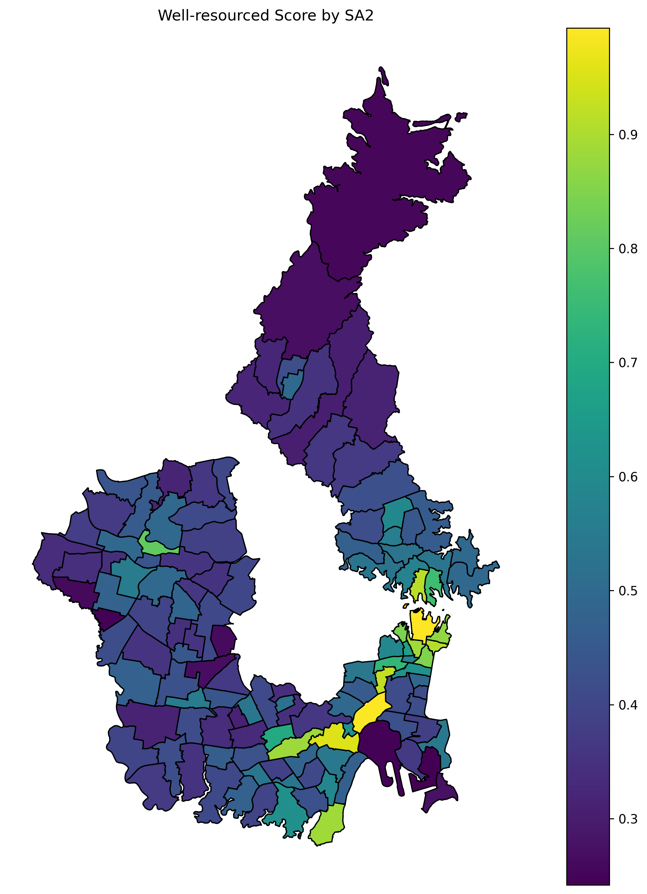
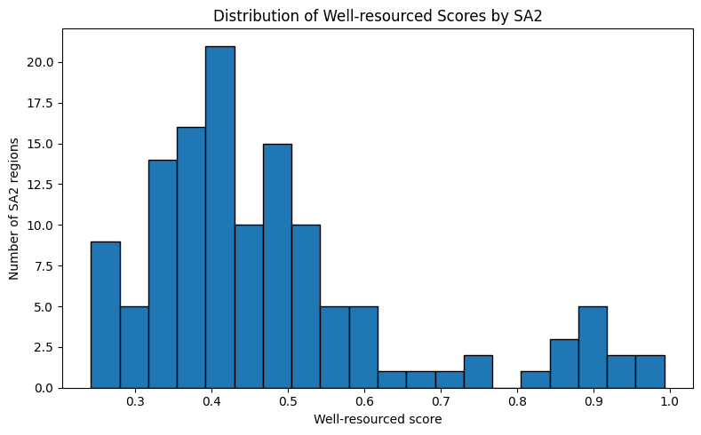

# Sydney POI spatial analysis

**悉尼 POI 空间分布与城市资源分析**

Where are points of interest concentrated across Sydney, and how do those patterns vary between neighbourhoods? This project combines government API data, ABS statistical boundaries and PostGIS spatial queries to compare POI density across four Greater Sydney SA4 regions.

**128 SA2 regions · 9,042 spatially matched POIs · Python + PostgreSQL/PostGIS**



[Read the report](reports/sydney_poi_report.pdf) · [Explore the analysis code](notebooks/sydney_poi_analysis.ipynb) · [View all SA2 results](results/tables/well_resourced_score_by_sa2.csv) · [中文说明](docs/README.zh-CN.md)

## What the project does

- Cleans ABS NSW regional indicators and derives five demographic and economic measures for 2019–2024.
- Queries the NSW POI API using SA2 bounding boxes, removes duplicates and creates point geometries in EPSG:4283.
- Loads points and polygons into PostgreSQL/PostGIS with spatial types, primary/foreign keys and GiST indexes.
- Uses `ST_Within` to replace approximate bounding-box membership with exact polygon membership.
- Compares POI density using a z-score and sigmoid transformation, with Python and SQL implementations.
- Produces ranked result tables, a choropleth map and an interactive Folium map.

This is a **Group31 team project for DATA2001 (2026)**, curated here as a portfolio repository. Individual ownership of team components is not asserted. The original submission has been organised for public review, with portable paths, credential-free configuration, independent verification scripts and documented execution-state corrections. See [provenance and reproducibility](docs/reproducibility.md).

## Findings

The published snapshot contains **18,209 raw query rows**, **10,627 unique valid-coordinate POIs**, and **9,042 POIs within the selected SA2 polygons**. Bounding-box overlap explains many duplicate query rows; the spatial join removes points outside the study area.

The median score is **0.428**. Sydney (North) – Millers Point ranks highest at **0.993**, with **98.37 POIs/km²**. Sydenham – Tempe – St Peters follows at **0.990**. Banksmeadow ranks lowest at **0.242**, with **1.02 POIs/km²**. These are comparisons within the selected four SA4s.



| SA4 region | Spatially assigned POIs |
| --- | ---: |
| Sydney – Inner South West | 2,861 |
| Sydney – North Sydney and Hornsby | 2,367 |
| Sydney – Parramatta | 2,086 |
| Sydney – City and Inner South | 1,728 |

NSW context indicators show businesses per 1,000 residents rising from **96.94 in 2020 to 105.73 in 2024**, while natural increase falls from **44,807 in 2021 to 32,496 in 2023**. These state-level trends provide context; they do not establish where business growth occurred within Sydney.

The score measures **POI concentration per unit area**. Facility capacity, population demand, travel time, cross-boundary access and land use are not modelled. Industrial zones and transport facilities need different interpretation from residential suburbs. Read the [findings and limitations](docs/findings.md) before using a ranking as an accessibility indicator.

## Method

For each SA2, `density = POI count / area in km²`. Standardise density across the 128 study regions using population standard deviation (`ddof=0`), then calculate:

```text
z = (density − mean density) / standard deviation
score = 1 / (1 + exp(−z))
```

This is the density-based implementation used in the submitted analysis. A score of 0.5 corresponds to the cohort mean density. The sigmoid is monotonic and preserves density ordering. Scores depend on the chosen study cohort.

## Review or verify the results

No database or packages are needed to verify the published scores and ABS indicators:

```bash
git clone https://github.com/xihu0859/sydney-poi-spatial-analysis.git
cd sydney-poi-spatial-analysis
python scripts/verify_results.py
```

To independently repeat the point-in-polygon assignment from the bundled historical raw POI records:

```bash
python -m pip install "shapely>=2,<3"
python scripts/verify_spatial_join.py
```

Both checks passed locally during curation. They reconcile all 128 spatial counts, the 9,042-POI total, scores, ranks, the saved SQL result, map properties and five derived NSW indicators. The included GitHub Actions workflow runs these checks when pushed; no remote CI result is claimed here.

For the full GeoPandas/PostGIS notebook, install `requirements.txt`, configure a dedicated database and follow [reproduction instructions](docs/reproducibility.md). Full database execution was not rerun during curation.

Download `results/maps/interactive_well_resourced_score_map.html` and open it in a browser to explore tooltips. GitHub displays HTML source; map tiles and JavaScript require an internet connection.

## Data and files

| Location | Contents |
| --- | --- |
| `notebooks/` | Curated full Python, API and PostGIS workflow |
| `sql/` | Extracted spatial assignment and SQL scoring queries |
| `data/raw/` | Historical POI query snapshot, ABS NSW source CSV and selected SA2 polygons |
| `data/interim/` | Cleaned data, feature candidates and bounding boxes |
| `data/audit/` | Separate population-filter audit; not the published scoring cohort |
| `results/tables/` | Scores, rankings, category counts and state-level statistics |
| `results/figures/` and `results/maps/` | Static map, interactive map and GeoJSON |
| `reports/` | Team report with duplicate and blank pages removed |

The 70 MB national shapefile is excluded. A compact, full-detail subset of the 128 study polygons supports reproduction without downloading all of Australia.

Data comes from **ABS Data by Region**, **ABS ASGS Edition 3 SA2 boundaries (2021)**, and **NSW Spatial Services Points of Interest**. This repository includes transformed and aggregated data; government sources do not endorse the analysis. Source links, licences and field definitions are in [data documentation](docs/data.md). Code and report authorship remains with the project contributors; upstream data retains its own terms. No blanket software licence has been assigned to team-authored material.
